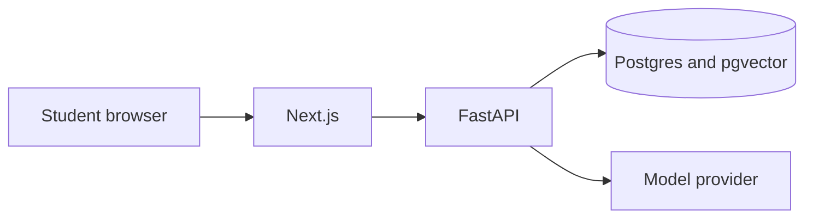

# Architecture

The tutor is a Next.js application and a FastAPI service. The browser talks only to the Next.js origin. Next.js proxies `/api` and `/health` to the API, so the session cookies stay on one site and can use `SameSite=Lax`.

A lesson turn does five things:

1. Screen the message for prompt injection, personal data, self-harm, and exam dumping.
2. Embed the question and retrieve curriculum chunks with vector search and full-text search.
3. Refuse, without calling a model, when nothing relevant was found.
4. Ask the configured model to answer from those chunks and cite them.
5. Check the citations. If they do not hold, the reply falls back to the retrieved passages.

Accounts are school-scoped. A student signs in with a school code and username. Teachers and admins may also use an email. The first admin is created with `python -m tutor_api.cli.seed_admin`, not a public route.

Curriculum files are PDFs. Ingestion extracts text, tables, and OCR when Tesseract is installed, chunks the pages, and stores a vector plus a `tsvector`. The default embedder is a hashed bag of words so the product runs without model weights. It is not bge-m3. See the embedding note in `docs/adr`.
